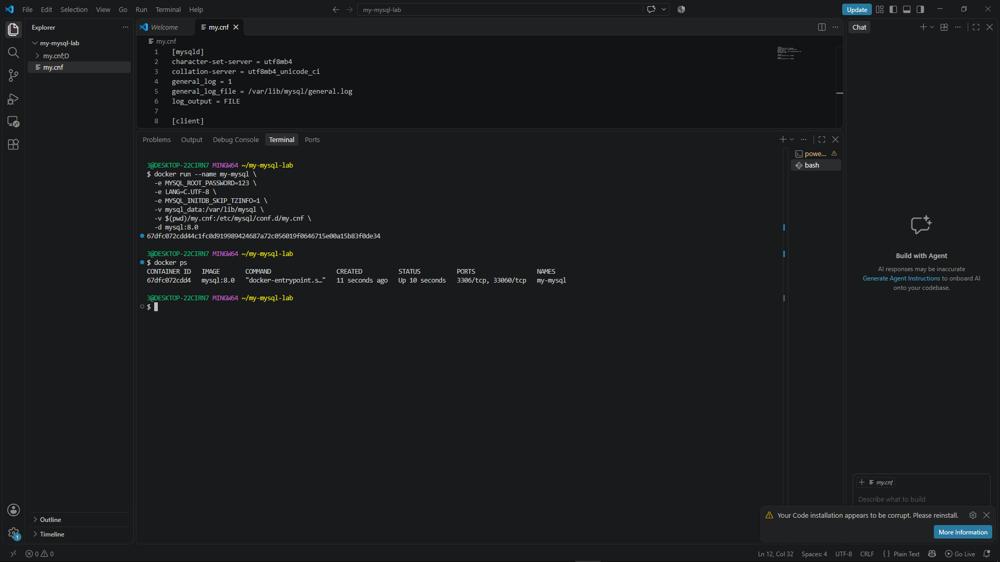
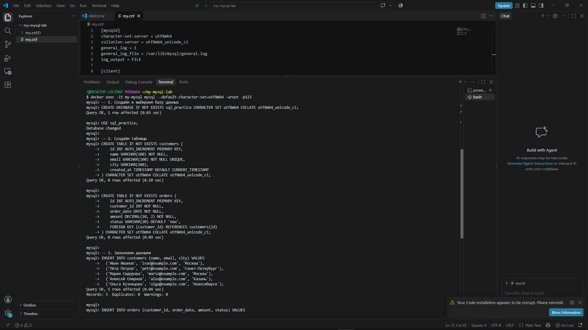
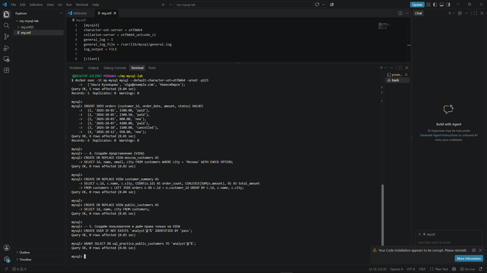
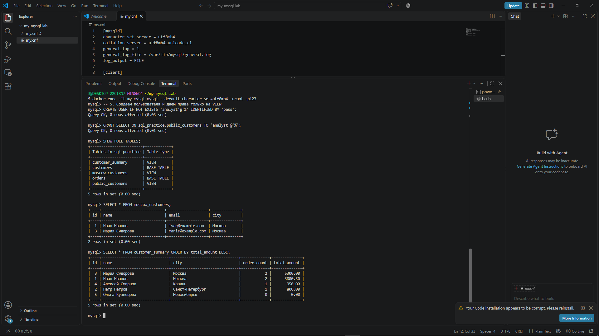
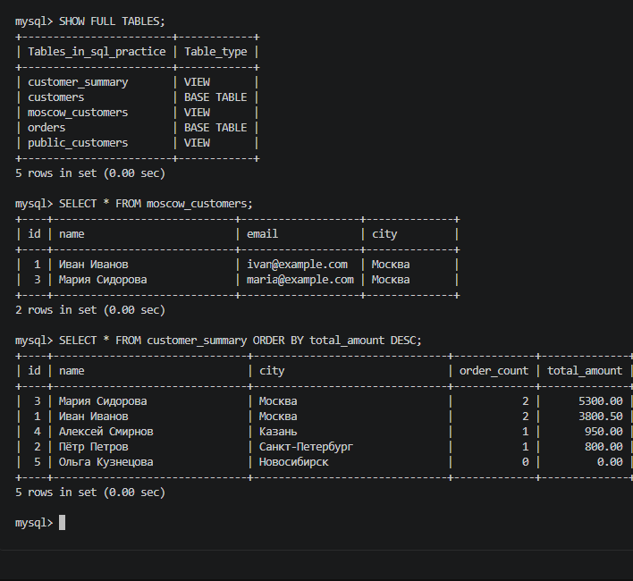
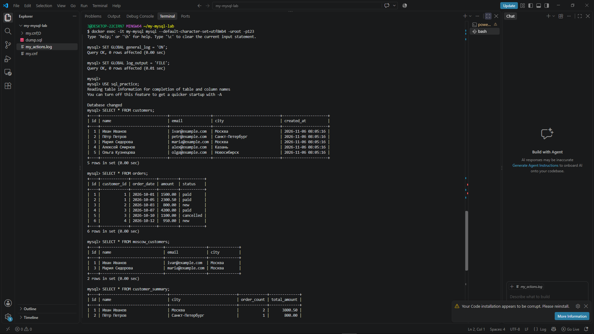
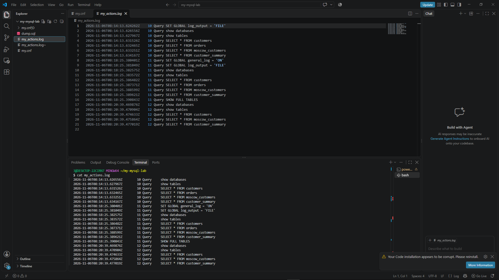

# Лабораторная работа: Представления (VIEW) в MySQL

**Выполнил:** Котохин Артем Ильич  
**Курс:** 2 курс, очное обучение  
**Специальность:** 09.02.07 "Информационные системы и программирование"  
**Дата выполнения:** 06.11.2026  

---

## 1. Цель работы
Изучение механизмов создания, использования и администрирования представлений (VIEW) в СУБД MySQL. Получение практических навыков работы с правами доступа, резервным копированием (дампом) и анализом логирования действий пользователя.

## 2. Задачи
1. Настроить окружение MySQL в Docker с включённым общим логом (`general_log`).
2. Создать учебную базу данных, таблицы `customers` и `orders` и наполнить их данными.
3. Реализовать различные типы представлений: простые, с агрегацией (`JOIN` + `GROUP BY`), с проверкой данных (`WITH CHECK OPTION`).
4. Настроить разграничение прав доступа для условного пользователя `analyst`.
5. Выполнить резервное копирование (дамп) и проанализировать лог выполненных запросов.

## 3. Ход работы

### 3.1. Подготовка окружения
Создан файл конфигурации `my.cnf` с кодировкой `utf8mb4` и включённым `general_log`. Развёрнут контейнер `my-mysql` на основе образа `mysql:8.0`.

### 3.2. Создание структуры данных
Создана БД `sql_practice`. Созданы таблицы `customers` и `orders` с внешним ключом (`FOREIGN KEY`). Таблицы наполнены тестовыми данными (5 клиентов, 6 заказов).

### 3.3. Работа с представлениями (VIEW)
1. Создано представление `moscow_customers` с опцией `WITH CHECK OPTION` для фильтрации клиентов по городу.
2. Создано представление `customer_summary` с использованием `LEFT JOIN` и агрегатных функций `COUNT`/`SUM`.
3. Создан пользователь `analyst`, которому предоставлено право `SELECT` только на представление `public_customers`.

### 3.4. Резервное копирование и логирование
- Создан дамп базы данных: `dump.sql`
- Проанализирован лог действий пользователя: `my_actions.log`

## 4. Результаты
В рабочей директории сформированы артефакты:
1. **`dump.sql`** – текстовый SQL-скрипт, содержащий полную структуру БД и определения всех представлений.
2. **`my_actions.log`** – отфильтрованный файл журнала, содержащий SQL-запросы (`show databases`, `show tables`, `SELECT * FROM customers`, `SELECT * FROM moscow_customers`, `SELECT * FROM customer_summary`, `SHOW FULL TABLES`).

## 5. Выводы
1. Представление (VIEW) является виртуальной таблицей и **не материализует данные**. Запрос выполняется заново при каждом обращении.
2. Опция `WITH CHECK OPTION` защищает от вставки некорректных данных.
3. VIEW эффективны для упрощения сложных запросов и контроля доступа.
4. Логирование через `general_log` позволяет отслеживать действия пользователей.

